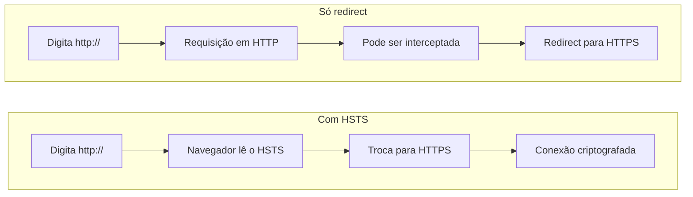
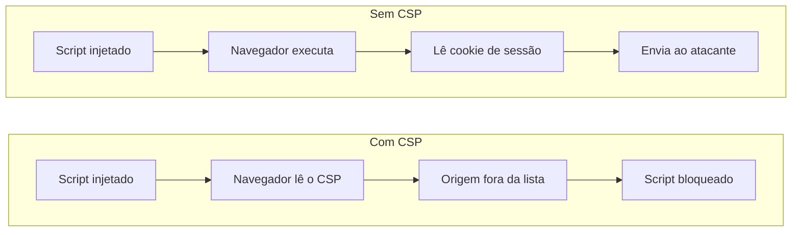
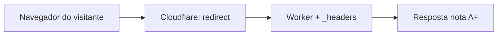

import ClickjackingDemo from '../../components/ClickjackingDemo.astro';
import HeadersGrade from '../../components/HeadersGrade.astro';

Rodei uma auditoria de segurança no meu próprio site de portfólio: estático, sem banco, sem login, sem formulário. Nota A logo no primeiro teste. Mesmo assim, encontrei uma brecha. Pequena, mas real, e numa camada que quase nunca aparece em code review: os headers HTTP. Ela fica entre o dev e a infra, e por isso costuma ficar sem dono.

Este artigo mostra o que encontrei, o que cada proteção faz, quais trade-offs aceitei e por que vale olhar a sua aplicação hoje.

## O diagnóstico

Passei a URL do feliperigler.dev no [securityheaders.com](https://securityheaders.com/). Nota A. Parecia ótimo, até ler o aviso:

> The site was served over HTTP and did not redirect to HTTPS.

Ou seja: o site tinha HTTPS, mas quem digitasse `http://` continuava em HTTP. Ter o certificado não adianta se ninguém é obrigado a usá-lo.

## Por que isso importa: o ataque da primeira requisição

Imagine alguém num Wi-Fi público de café digitando `feliperigler.dev`. O navegador tenta HTTP primeiro. Nesse instante, um atacante na mesma rede pode interceptar a conexão e:

- servir uma versão falsa do site;
- injetar scripts ou alterar links;
- roubar cookies, se houver sessão.

Isso se chama **downgrade** ou **SSL stripping**. No meu portfólio, o dano seria limitado. Numa aplicação com login, é sequestro de sessão.

A diferença entre só redirecionar e usar HSTS:



**A reviravolta:** o meu site, especificamente, estava protegido desse ataque por um detalhe que eu nem sabia. O TLD `.dev` inteiro está na lista de HSTS preload dos navegadores, com todos os subdomínios. Ou seja, Chrome, Firefox e Safari já saem de fábrica recusando HTTP para qualquer endereço `.dev`. Já um `.com.br` ou `.com` não tem essa proteção. A aplicação Laravel da sua empresa provavelmente está num desses.

## As correções e seus trade-offs

### 1. Redirecionar sempre para HTTPS

**O que faz:** toda requisição HTTP recebe um redirect 301 para HTTPS. Na Cloudflare, é o "Always Use HTTPS".

**O que evita:** usuário navegando sem criptografia.

**Trade-off:** por que isso não vem ligado por padrão? Porque quebra coisas. Páginas com conteúdo misto (imagens ou scripts em HTTP), APIs antigas cujos clientes fazem POST em HTTP (muitos clientes transformam o POST em GET ao seguir um 301), e origens mal configuradas que geram loop de redirecionamento.

**Limitação:** o redirect só acontece *depois* da primeira requisição HTTP. A brecha do café continua aberta. Por isso existe o próximo item.

### 2. HSTS (Strict-Transport-Security)

**O que faz:** o servidor diz ao navegador: "pelos próximos X segundos, nunca fale comigo em HTTP". O navegador grava a regra e, nas visitas seguintes, nem tenta HTTP.

**O que evita:** a primeira requisição insegura, downgrade e roubo de cookies em rede hostil.

**Trade-off:** é uma promessa difícil de desfazer. Enquanto o `max-age` valer, se o seu HTTPS falhar (certificado expirado, migração para uma hospedagem sem TLS), o visitante fica bloqueado. O navegador não oferece o botão "continuar mesmo assim".

As opções, e o que o meu `_headers` usa:

| Opção | O que faz | No meu site | Por quê |
| --- | --- | --- | --- |
| max-age | Tempo que o navegador guarda a regra | 2 anos (63072000 s) | Certificado renovado automaticamente pela Cloudflare: risco baixo de expirar |
| includeSubDomains | Aplica a regra a todos os subdomínios | Ligado | Num `.dev`, os subdomínios já são HTTPS obrigatório de qualquer forma |
| preload | Pede inclusão na lista embutida nos navegadores | Ligado | Num `.dev`, o TLD inteiro já está na lista: não amarra nada a mais |

Num `.com.br`, eu seria mais conservador: começar com `max-age` curto, sem includeSubDomains e sem preload, e só subir quando todo o domínio estivesse 100% em HTTPS. Sair da lista de preload leva meses.

Regra prática: comece com `max-age` curto, aumente quando tiver certeza, e só pense em preload quando todo o domínio, subdomínios incluídos, estiver 100% em HTTPS.

### 3. X-Content-Type-Options: nosniff

**O que faz:** proíbe o navegador de "adivinhar" o tipo de um arquivo (MIME sniffing).

**O que evita:** um arquivo enviado como "imagem" que, na verdade, contém script e acaba sendo executado.

**Trade-off:** quase nenhum. Só quebra se o seu servidor declara tipos errados, o que já é um bug.

### 4. Content-Security-Policy (CSP)

**O que faz:** uma lista de origens permitidas para scripts, estilos, imagens e fontes.

**O que evita:** XSS. Mesmo que alguém consiga injetar um `<script>` (num comentário, numa dependência comprometida), o navegador se recusa a executar o que não está na lista.



**Trade-off:** é o header mais poderoso e o mais chato. Uma política restrita demais quebra fontes do Google, analytics, widgets. Toda nova dependência externa exige atualizar a política. Dica: comece com `Content-Security-Policy-Report-Only`, que só reporta violações sem bloquear.

### 5. X-Frame-Options: DENY

**O que faz:** impede que seu site seja carregado dentro de um iframe em outro domínio.

**O que evita:** clickjacking: o atacante coloca seu site num iframe invisível e engana o usuário para clicar em botões reais.

<ClickjackingDemo />

no meu site isso é impossível: o `frame-ancestors 'none'` impede qualquer site de me embutir.

Na demo, a vítima vê só a camada de baixo. O clique, porém, atravessa a camada de cima, que está transparente. Com `X-Frame-Options: DENY` (ou `frame-ancestors 'none'`), o navegador se recusa a carregar o seu site dentro de outro, e essa camada de cima nem existe.

**Trade-off:** você também não pode embutir o site em lugares legítimos. Para isso, a diretiva `frame-ancestors` do CSP dá controle mais fino.

### 6. Referrer-Policy

**O que faz:** controla quanto da URL de origem vai para outros sites quando alguém clica num link.

**O que evita:** vazamento de dados na URL (tokens, IDs, parâmetros de busca).

**Trade-off:** políticas muito restritas reduzem a informação de origem que outros sites (e o seu analytics) recebem.

## Como ficou

O caminho de cada requisição:



No painel da Cloudflare ficou só o **Always Use HTTPS**. Todo o resto vive versionado no Git, num arquivo `_headers` na pasta `public` do projeto, que o build copia para o `dist` e a Cloudflare aplica a cada resposta estática:

```
/*
  Content-Security-Policy: default-src 'self'; script-src 'self'; style-src 'self'; style-src-attr 'unsafe-inline'; img-src 'self' data: https://i.ytimg.com; font-src 'self'; frame-src https://www.youtube-nocookie.com; connect-src 'self'; object-src 'none'; base-uri 'self'; form-action 'self'; frame-ancestors 'none'; upgrade-insecure-requests
  Strict-Transport-Security: max-age=63072000; includeSubDomains; preload
  X-Content-Type-Options: nosniff
  X-Frame-Options: DENY
  Referrer-Policy: strict-origin-when-cross-origin
  Permissions-Policy: camera=(), microphone=(), geolocation=(), payment=(), usb=(), interest-cohort=()
  Cross-Origin-Opener-Policy: same-origin
```

Destaques: o CSP não permite script nem `<style>` inline (só atributos `style=""`), libera vídeos apenas pelo `youtube-nocookie`, e `frame-ancestors 'none'` bloqueia iframes. O Permissions-Policy desliga câmera, microfone e localização, e o Cross-Origin-Opener-Policy isola a página de janelas abertas por outros sites.

Uma lição extra: configurar o mesmo header em dois lugares (painel e arquivo) cria duas fontes da verdade. Escolha uma, de preferência a versionada.

Resultado: de **A** para **A+**.

## E a sua aplicação?

Agora a parte que me incomodou. Em 14 anos de PHP e Laravel, quase nunca vi esses headers discutidos em code review. O Laravel te protege bem em várias frentes:

- **CSRF** nos formulários;
- **escape automático** no Blade contra XSS;
- **Eloquent** com prepared statements contra SQL injection.

Mas ele **não** envia CSP nem HSTS por padrão. Se ninguém configurou no Nginx, no load balancer ou na CDN, a sua aplicação pode estar:

- aceitando a primeira requisição em HTTP, com o cookie de sessão viajando aberto num Wi-Fi público;
- executando qualquer script que um dia escapar de um `{!! !!}` esquecido;
- podendo ser embutida num iframe para clickjacking no botão "confirmar pagamento".

No Laravel, dá para resolver com um middleware próprio, um pacote como `spatie/laravel-csp`, ou direto na camada de infraestrutura.

Resumo por gravidade, pensando numa aplicação com login:

<HeadersGrade />

## Teste agora

1. Abra o [securityheaders.com](https://securityheaders.com/) e cole a URL da sua aplicação.
2. Ou no terminal: `curl -I https://sua-aplicacao.com`.
3. Para cada header faltando, pergunte: qual ataque isso evita aqui, e o que pode quebrar se eu ligar?

Saída real de `curl -I https://feliperigler.dev`, em 15/11/2026 (só os headers de segurança e a linha de status):

<div className="term" role="region" aria-label="Saída do curl -I para feliperigler.dev">
  <div className="term__barra"><span>// TERMINAL</span><span>curl -I</span></div>
  <pre className="term__corpo"><code><span className="term__cmd">$ curl -I https://feliperigler.dev</span>
<span>HTTP/2 200</span>
<span>date: Sun, 15 Nov 2026 16:10:06 GMT</span>
<span>content-type: text/html</span>
<span className="term__hl">strict-transport-security: max-age=63072000; includeSubDomains; preload</span>
<span className="term__hl">content-security-policy: default-src 'self'; script-src 'self'; style-src 'self'; style-src-attr 'unsafe-inline'; img-src 'self' data: https://i.ytimg.com; font-src 'self'; frame-src https://www.youtube-nocookie.com; connect-src 'self'; object-src 'none'; base-uri 'self'; form-action 'self'; frame-ancestors 'none'; upgrade-insecure-requests</span>
<span>cross-origin-opener-policy: same-origin</span>
<span>permissions-policy: camera=(), microphone=(), geolocation=(), payment=(), usb=(), interest-cohort=()</span>
<span>referrer-policy: strict-origin-when-cross-origin</span>
<span>x-content-type-options: nosniff</span>
<span className="term__hl">x-frame-options: DENY</span>
<span>server: cloudflare</span></code></pre>
</div>

Destaques: o **CSP** (`frame-ancestors 'none'`), o **Strict-Transport-Security** (2 anos, com subdomínios e preload) e o **X-Frame-Options: DENY**.

Segurança não é ligar tudo no máximo. É saber qual risco você está aceitando, e escolher isso de propósito.
